# FacilityOps – Arıza / Talep Takip API

 

İstasyon ve tesis bazında (gar, havalimanı, trafo merkezi vb.) arıza kayıtlarını yöneten, **C# / .NET 8** ile yazılmış REST API.
Kurumsal projelerde yaygın kullanılan yığınla geliştirildi: ASP.NET Core, Entity Framework Core (Migrations), **SQL Server** (geliştirmede SQLite), JWT, xUnit, Docker, CI.

## Özellikler
- **Arıza yaşam döngüsü:** `Açık → Atandı → Çözüldü → Kapandı`. Atlama/geri dönüş engellenir (409).
- **SLA takibi:** Öncelik başına hedef çözüm süresi (Kritik 4 saat, Yüksek 24 saat, Normal 72 saat, Düşük 7 gün); geciken kayıtlar filtrelenir ve özette sayılır.
- **Arıza işlem geçmişi:** Her arıza işlemi (kim, ne zaman, hangi durumdan hangisine) `/arizalar/{id}/gecmis` ile izlenebilir; durum değişikliği ve kayıt aynı işlemde yazılır.
- **Genel denetim kaydı (audit log):** Giriş ve başarısız giriş, kullanıcı kaydı, şifre değişimi, rol/durum değişikliği, istasyon ekleme ve yenileme tokenı tekrar kullanımı (güvenlik olayı) `DenetimKayitlari` tablosuna yazılır; yalnızca Yönetici `/denetim` ile sorgular (kullanıcı, işlem, tarih süzgeci, sayfalama). Kayıt, asıl değişiklikle aynı işlemde (atomik) yazılır; parola ve token kayda girmez.
- **Kimlik doğrulama ve yetki:** JWT, rol bazlı (Personel / Yönetici); şifreler PBKDF2 ile hashlenir.
- **Sayfalama ve filtreleme:** durum, öncelik, gecikme; sayfa boyutu üst sınırlı (100).
- **Dışa aktarma** (yalnızca Yönetici): arızalar CSV (Excel uyumlu, UTF-8 BOM, formül enjeksiyonuna karşı kaçışlı) ve **Excel (.xlsx)**; denetim kaydı Excel. Excel'de metin hücreleri her zaman düz metin yazılır, `=…` ile başlayan girdi formül olarak çalışmaz.
- **Dayanıklılık ve güvenlik:** RFC 7807 hata yanıtları, beklenmeyen hatalarda ayrıntı sızdırmama, giriş uçlarında hız sınırı (429), güvenlik başlıkları, `/saglik` sağlık ucu.
- **Veritabanı:** SQL Server (üretim önerisi) ve SQLite (varsayılan; geliştirme ve testler), `Database:Provider` ile seçilir. EF Core Migrations (uygulama açılışında uygulanır; her sağlayıcının migration kümesi ayrıdır), indeksler, kısıtlı yabancı anahtarlar.
- Swagger arayüzü (`/swagger`, Bearer token desteği).

## Web arayüzü
API çalışırken kök adres (`/`) bir operasyon paneli sunar. Ek bir derleme adımı yoktur; dosyalar `src/FacilityOps.Api/wwwroot` altındadır (sade HTML, CSS ve JavaScript, harici bağımlılık yok).

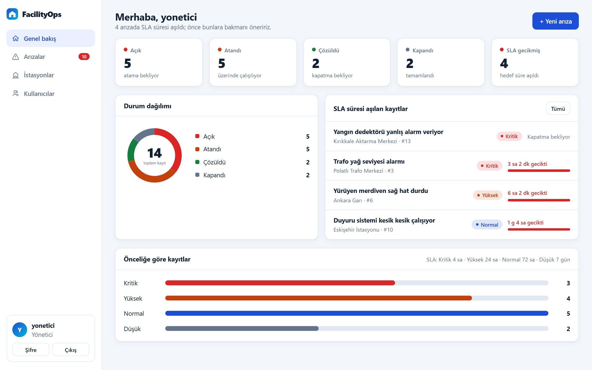

- **Genel bakış:** durum kartları (tıklayınca ilgili listeyi açar), durum dağılımı halka grafiği, SLA süresi aşılan kayıtlar ve önceliğe göre dağılım
- **SLA göstergesi:** her açık arızada kalan süre ve doluluk çubuğu; süre dolmadan önce (%75 sonrası) turuncu, dolunca kırmızı ve "x sa gecikti"
- **Arıza listesi:** arama, durum / öncelik / geciken filtresi, sayfalama; yönetici için CSV dışa aktarma
- **Detay çekmecesi:** SLA kartı, atama ve yeniden atama, çözüldü olarak işaretleme, kapatma (yönetici) ve zaman çizelgesi biçiminde işlem geçmişi
- **İstasyonlar, kullanıcılar (yönetici):** rol değiştirme, pasife alma; şifre değiştirme
- **Denetim kaydı (yönetici):** kullanıcı ve işlem süzgeci, sayfalama, Excel indirme; arıza listesinde Excel ve CSV indirme

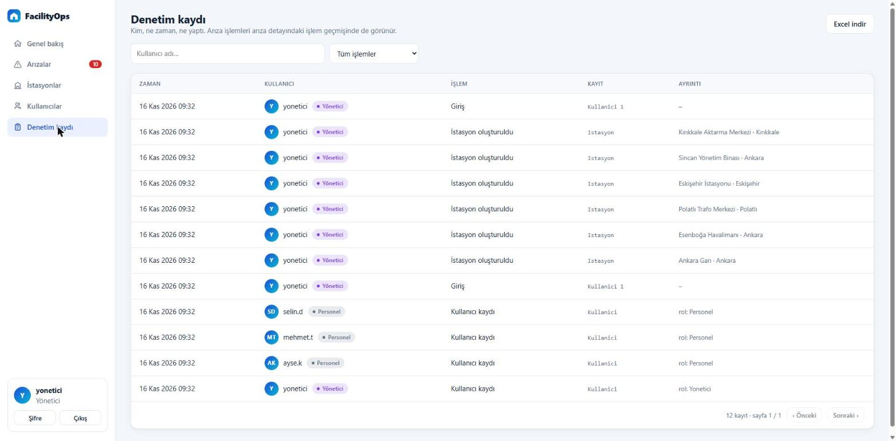
- Oturum süresi dolunca yenileme tokenı ile sessizce yenilenir; mobilde ve koyu temada kullanılabilir

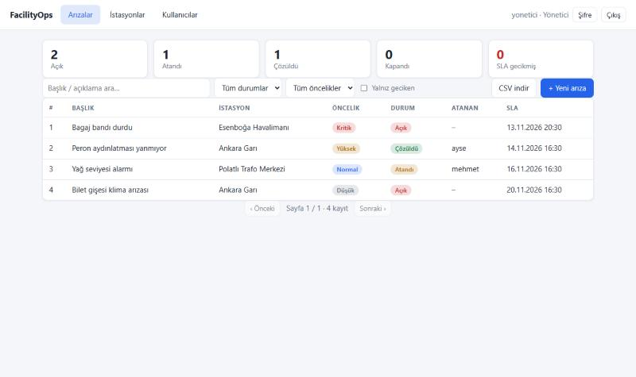

| Detay çekmecesi | Yeni arıza |
|---|---|
| 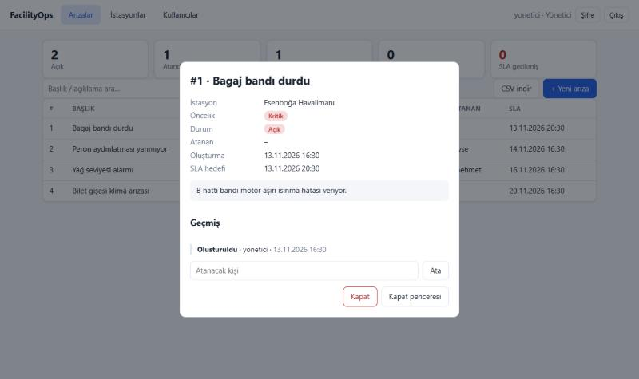 | 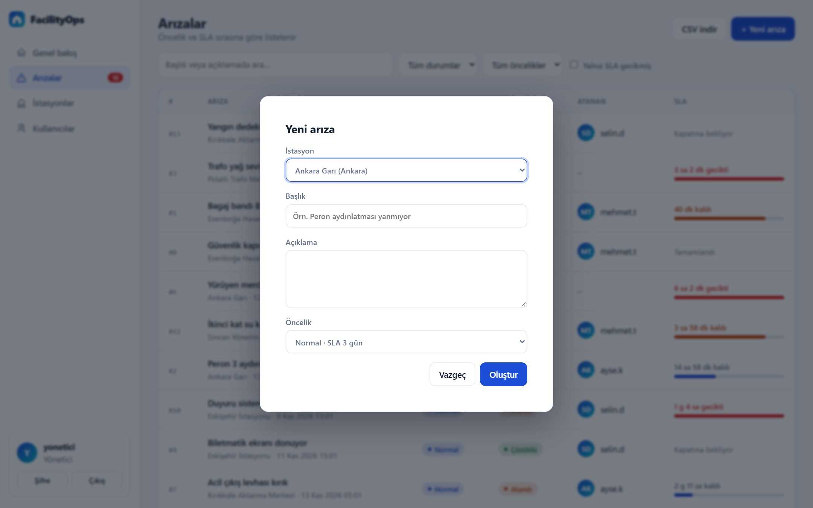 |

| Giriş | Kullanıcı yönetimi | Mobil |
|---|---|---|
| 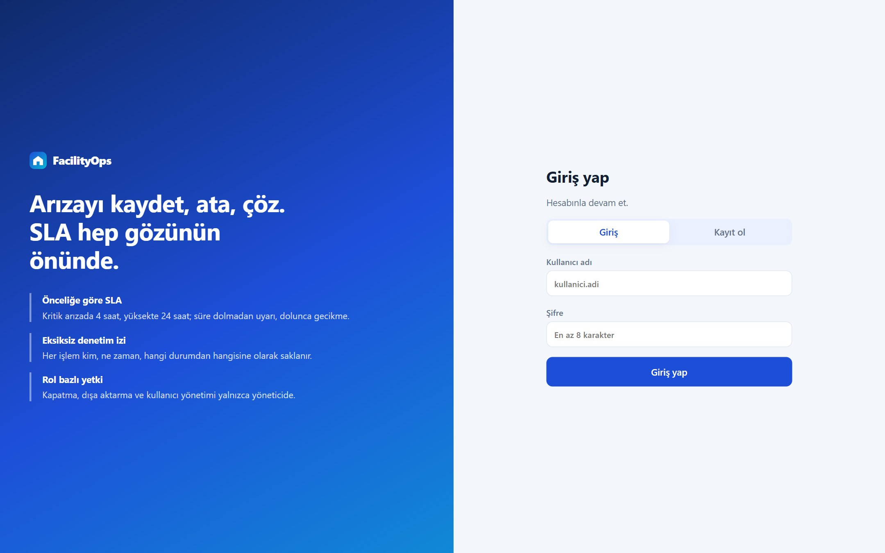 | 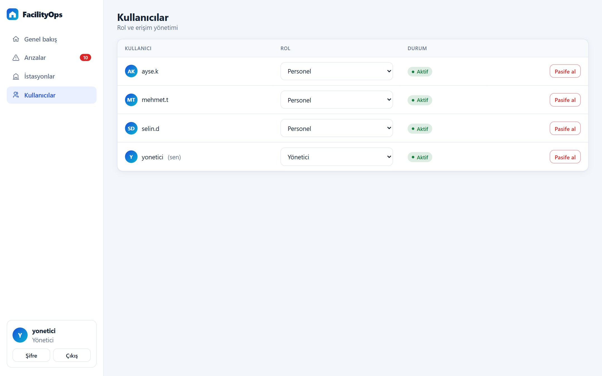 | 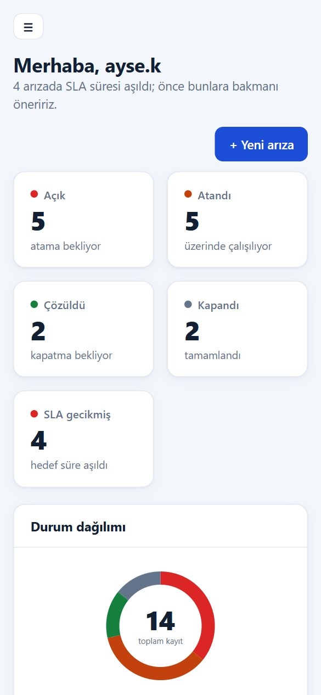 |

Güvenlik: metinler `textContent` ile yazılır (`innerHTML` yok), sayfa `Content-Security-Policy` ile sunulur ve satır içi betik/stil kullanmaz. Tokenlar `sessionStorage`'da tutulur ve sekme kapanınca silinir.

**Denemek için:** boş bir veritabanıyla uygulamayı başlatın ve demo verisini yükleyin (Node 18+). Betik 4 kullanıcı (ilk kayıt olan `yonetici` Yönetici olur), 6 istasyon ve farklı durumlarda 14 arıza oluşturur; ortak demo şifresi betiğin başında yazar, yalnızca yerel denemede kullanın:
```bash
node scripts/demo-verisi.mjs http://localhost:8080
```

## Ekran görüntüleri

Çalışan API'nin Swagger arayüzü (demo verisiyle). Sağ üstteki **Authorize** düğmesine `/auth/giris` ile alınan erişim tokenı girilir:

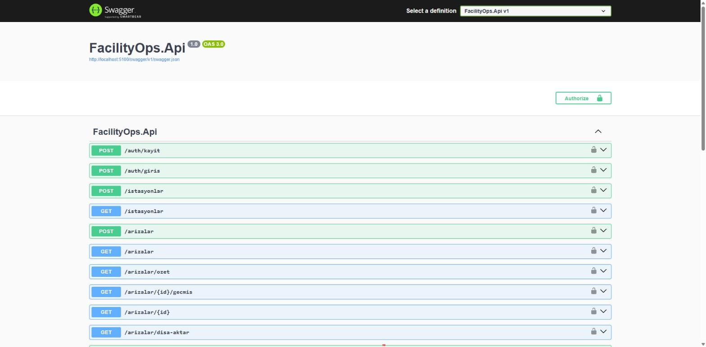

Yetkilendirilmiş bir istek ve yanıtı (güvenlik başlıklarıyla birlikte):

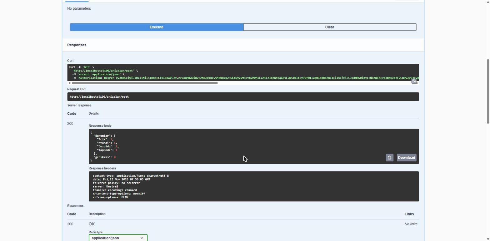
## Mimari
| Katman | Klasör | Sorumluluk |
|---|---|---|
| Domain | `Domain/` | Varlıklar, enum'lar, istek/yanıt modelleri |
| Data | `Data/` | EF Core `DbContext`, ilişkiler, indeksler; `Migrations/` (SQLite) ve `MigrationsSqlServer/` (SQL Server), `SqlServerDbContext` |
| Servis | `Services/` | İş kuralları, denetim, SLA, CSV (HTTP'den bağımsız, test edilebilir) |
| API | `Program.cs` | Minimal API uç noktaları, kimlik doğrulama, hata ve güvenlik ara katmanları |
| Arayüz | `wwwroot/` | Bağımlılıksız web arayüzü (HTML, CSS, JS), API ile aynı kökten sunulur |

## Veritabanı şeması

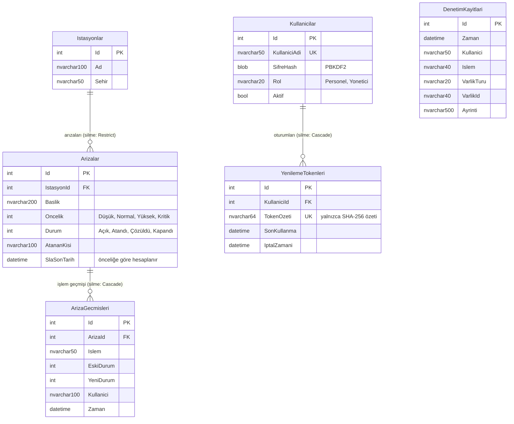

`DenetimKayitlari`, `Kullanicilar` ile yabancı anahtarla bağlı değildir: kullanıcı adı kayıt anında metin olarak yazılır (başarısız girişte var olmayan bir ad da yazılabilir, kullanıcı pasife alınsa bile geçmiş anlamını korur). Şema EF Core migration'larından üretilir: SQL Server için `Data/MigrationsSqlServer/`, SQLite için `Data/Migrations/` (tür adları SQL Server'a göredir). İki küme de aynı modelden üretilir; SQL Server kümesi gerçek bir SQL Server'a karşı testle doğrulanır.

## Çalıştırma

Docker ile tek komut: **SQL Server** ve API birlikte kalkar, migration'lar açılışta uygulanır (arayüz ve Swagger: http://localhost:8080):
```bash
docker compose up --build
```
`JWT_KEY` ve `SA_PASSWORD` verilmezse `docker-compose.yml` içindeki yerel deneme değerleri kullanılır; gerçek ortamda `.env` ile verin (`JWT_KEY` en az 32 karakter, `SA_PASSWORD` SQL Server karmaşıklık kurallarını sağlamalı; üretimde `sa` yerine ayrı bir veritabanı hesabı kullanın). Veri `facilityops-sql` biriminde kalıcıdır (`docker compose down -v` siler).

**Veritabanı sağlayıcısı:** `Database__Provider` ortam değişkeni `Sqlite` (varsayılan) veya `SqlServer` olur. SQL Server için `ConnectionStrings__Default` zorunludur (örn. `Server=sunucu,1433;Database=FacilityOps;User Id=...;Password=...;TrustServerCertificate=True`); bilinmeyen bir sağlayıcı değerinde ya da bağlantı dizesi eksikse uygulama başlamaz. Yerelde `dotnet run` ayar gerektirmeden SQLite dosyası (`facilityops.db`) kullanır.

```bash
# Geliştirmede appsettings.Development.json içindeki örnek anahtar kullanılır.
dotnet run --project src/FacilityOps.Api
dotnet test
```

Yalnızca API imajı, SQLite ile (tek konteyner):
```bash
docker build -t facilityops .
docker run -p 8080:8080 -e Jwt__Key=<en-az-32-karakterlik-gizli-anahtar> -e Jwt__Issuer=FacilityOps -e Jwt__Audience=FacilityOps.Istemci -v facilityops-data:/data facilityops
```
Üretimde `Jwt__Key` ortam değişkeni zorunludur; yoksa uygulama başlamaz.

**Ters vekil (nginx/ingress) arkasında:** Giriş uçlarının hız sınırı istemci IP'sine göre uygulanır. Uygulama bir vekilin arkasındaysa tüm istekler vekilin adresinden gelmiş görünür ve kullanıcılar aynı kovayı paylaşır. Bunu önlemek için `Proxy__GuvenilirBaslik=true` ayarlayın; bu durumda `X-Forwarded-For` ve `X-Forwarded-Proto` başlıklarına güvenilir. Varsayılan **kapalıdır**: uygulamaya doğrudan erişilebiliyorsa istemci bu başlığı sahteleyip hız sınırını atlayabilir. Yalnızca uygulamaya sadece vekil üzerinden erişilen kurulumlarda açın.

## Yetkilendirme
- `POST /auth/kayit` ile ilk kayıt olan kullanıcı **Yönetici**, sonrakiler **Personel** olur.
- `POST /auth/giris` kısa ömürlü bir erişim tokenı (varsayılan 15 dk) ve bir **yenileme tokenı** (varsayılan 7 gün) döner; istekler `Authorization: Bearer <erişim tokenı>` ile yapılır.
- `POST /auth/yenile` yenileme tokenını **döndürür**: eski token iptal edilir, yeni bir çift verilir. İptal edilmiş bir token tekrar sunulursa çalınmış sayılır ve o kullanıcının tüm oturumları kapatılır.
- Yenileme tokenının kendisi veritabanında tutulmaz, yalnızca SHA-256 özeti saklanır. Süreler `Jwt__ErisimDakika` ve `Jwt__YenilemeGun` ile ayarlanır.
- Süresi dolmuş yenileme tokenı kayıtları arka planda düzenli silinir (`Jwt__TemizlikDakika`, varsayılan 60; 0 kapatır; `Jwt__TemizlikSaklamaSaat`, varsayılan 24). İptal edilmiş ama süresi dolmamış kayıtlar bilerek tutulur: tekrar kullanım (çalınma) tespiti bunlara dayanır.
- Şifre değişince, kullanıcı pasife alınınca veya rolü değişince o kullanıcının yenileme tokenları iptal edilir. Daha önce verilmiş erişim tokenı en fazla erişim süresi kadar (15 dk) geçerli kalır.
- Sistemde en az bir aktif Yönetici kalmalıdır; son yönetici pasife alınamaz ya da rolü düşürülemez (409).
- Arıza kapatma (`/kapat`) ve CSV dışa aktarma yalnızca Yönetici'ye açıktır; diğer uç noktalar giriş yapmış herkese.

## Uç noktalar
| Yöntem | Yol | Açıklama |
|---|---|---|
| POST | `/auth/kayit`, `/auth/giris` | Kayıt, giriş (hız sınırlı) |
| POST | `/auth/yenile`, `/auth/cikis` | Yenileme tokenı ile yeni çift al (döndürme) / oturumu kapat (hız sınırlı) |
| POST | `/auth/sifre-degistir` | Kendi şifreni değiştir; diğer oturumlar kapanır |
| GET | `/kullanicilar` | Kullanıcı listesi (Yönetici) |
| PUT | `/kullanicilar/{id}/rol`, `/kullanicilar/{id}/durum` | Rol (Personel/Yonetici) ve aktif/pasif değiştir (Yönetici) |
| POST/GET | `/istasyonlar` | İstasyon ekle / listele |
| POST | `/arizalar` | Arıza aç (SLA hesaplanır) |
| GET | `/arizalar?durum=&oncelik=&gecikmis=&sayfa=&boyut=` | Sayfalı, filtreli liste |
| GET | `/arizalar/ozet` | Durum bazında sayılar ve geciken adedi |
| GET | `/arizalar/{id}/gecmis` | Denetim kaydı |
| POST | `/arizalar/{id}/ata`, `/coz` | Atama, çözme |
| POST | `/arizalar/{id}/kapat` | Kapatma (Yönetici) |
| GET | `/arizalar/disa-aktar`, `/arizalar/disa-aktar.xlsx` | CSV / Excel (Yönetici) |
| GET | `/denetim?kullanici=&islem=&baslangic=&bitis=&sayfa=&boyut=` | Genel denetim kaydı (Yönetici) |
| GET | `/denetim/disa-aktar.xlsx` | Denetim kaydı Excel (Yönetici) |
| GET | `/saglik` | Sağlık kontrolü |

## Testler
xUnit ile 103 test: iş kuralları ve SLA (SQLite in-memory), sayfalama, arıza işlem geçmişi, genel denetim kaydı (giriş ve başarısız giriş, rol/durum/şifre/istasyon işlemleri, token tekrar kullanımı, parola ve token'ın kayda girmemesi, yalnızca Yönetici erişimi, süzgeç ve sayfalama), CSV ve Excel çıktısı (formül enjeksiyonu koruması) ve `WebApplicationFactory` ile uçtan uca API akışı (arayüz sunumu ve içerik güvenlik politikası, giriş, token yenileme ve tekrar kullanım koruması, şifre değiştirme, kullanıcı yönetimi, rol kontrolü, hız sınırı, hata biçimi, güvenlik başlıkları).
**SQL Server testleri** (3 test) uygulamayı `Database:Provider=SqlServer` ile gerçek bir SQL Server'a karşı çalıştırır: migration'ların uygulanması, benzersiz dizinler ve kısıtlı yabancı anahtar, büyük/küçük harf duyarsız arama, durum akışı, denetim kaydı ve Excel çıktısı. Her çalıştırma kendi geçici veritabanını kurar ve siler; `FACILITYOPS_TEST_SQL` tanımlı değilse atlanır:
```powershell
$env:FACILITYOPS_TEST_SQL = 'Server=(localdb)\mssqllocaldb;Integrated Security=true;TrustServerCertificate=True'
dotnet test
```
Ayrıca sağlayıcı ayarının doğrulanması ve bozuk istek gövdesinin (ör. metin olarak gönderilen enum) 500 yerine 400 ile reddedilmesi test edilir.
GitHub Actions (`.github/workflows/ci.yml`) her push ve pull request'te bir SQL Server servisiyle derleme (uyarılar hata sayılır) ve tüm testleri çalıştırır.

## Sonraki adımlar
PostgreSQL desteği (SQL Server ve SQLite var), erişim tokenının anlık iptali (şu an en fazla 15 dk geçerli kalır). SQLite'tan SQL Server'a veri taşıma aracı yoktur: SQLite yalnızca geliştirme içindir, mevcut bir SQLite veritabanı SQL Server'a otomatik aktarılmaz.

**Denetim kaydının sınırları:** Tablo uygulama tarafında yalnızca eklenir, ancak veritabanı düzeyinde güncelleme/silme engellenmemiştir; saklama/arşivleme politikası yoktur. Arıza oluşturma/atama/çözme/kapatma işlemleri genel denetim kaydında değil, arıza işlem geçmişindedir; okuma istekleri kayda alınmaz.

## Lisans

Bu proje [MIT Lisansı](LICENSE) ile paylaşılmaktadır.
