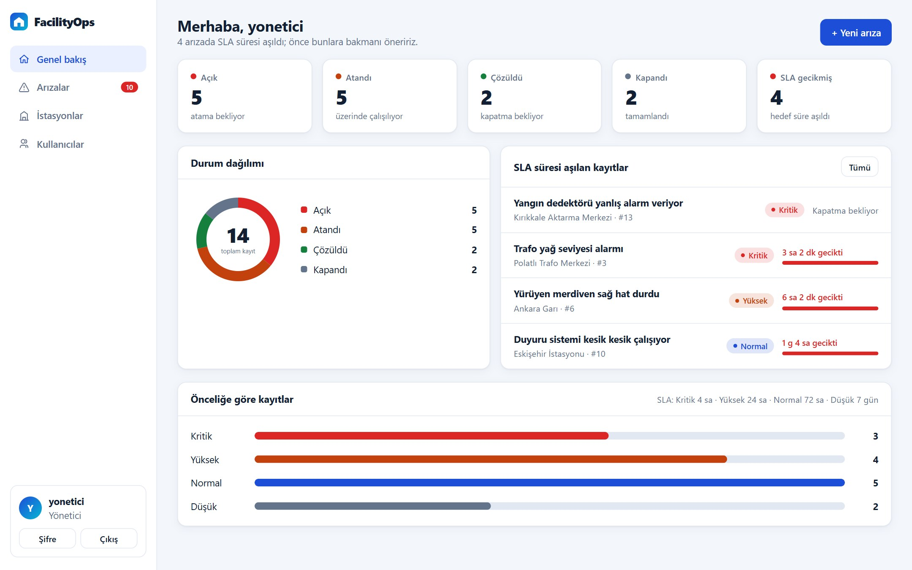
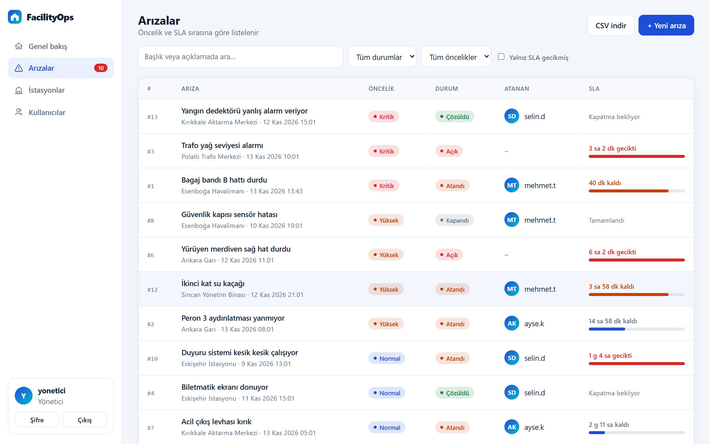
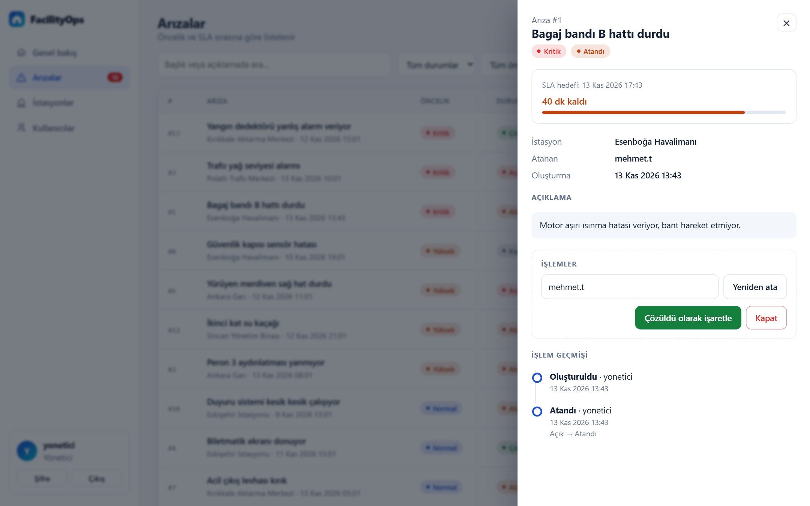
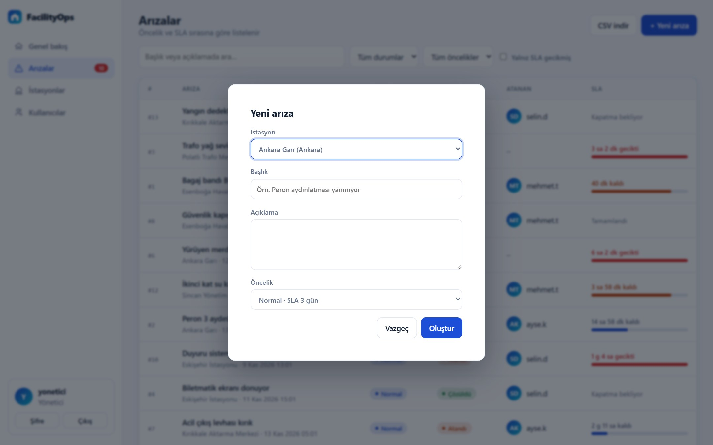
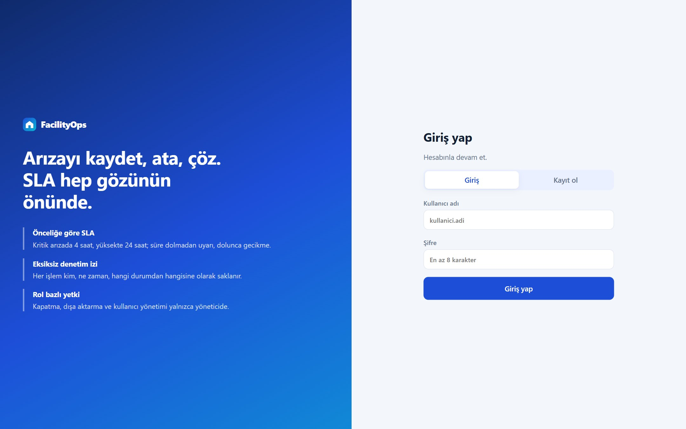
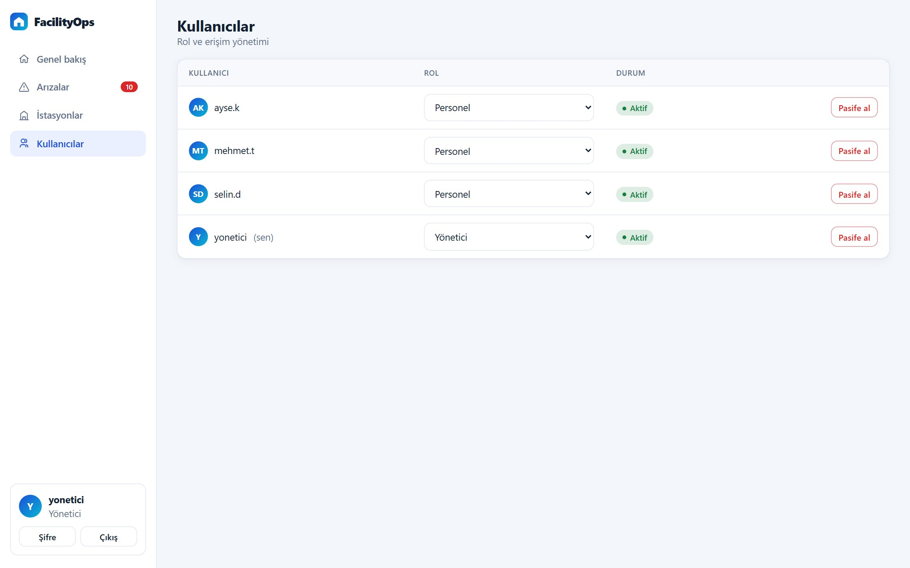
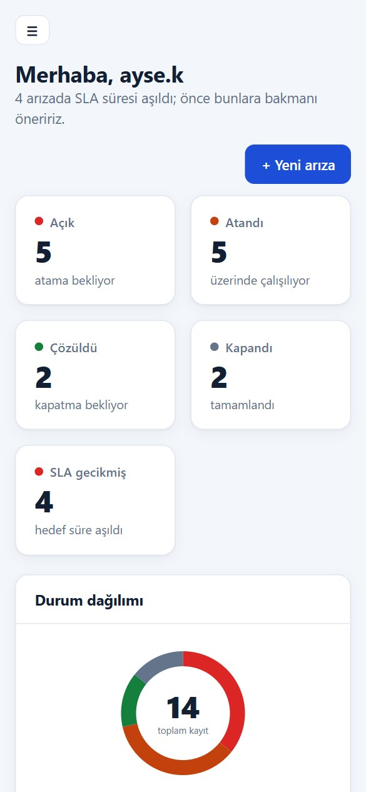
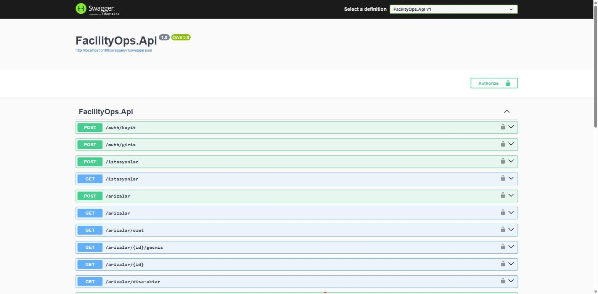
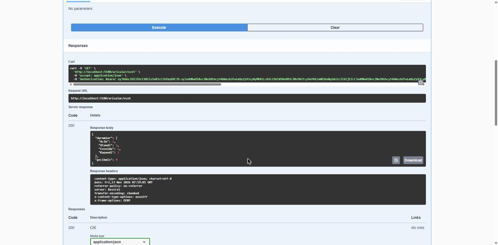

# FacilityOps – Arıza / Talep Takip API

 

İstasyon ve tesis bazında (gar, havalimanı, trafo merkezi vb.) arıza kayıtlarını yöneten, **C# / .NET 8** ile yazılmış REST API.
Kurumsal projelerde yaygın kullanılan yığınla geliştirildi: ASP.NET Core, Entity Framework Core (Migrations), SQL, JWT, xUnit, Docker, CI.

## Özellikler
- **Arıza yaşam döngüsü:** `Açık → Atandı → Çözüldü → Kapandı`. Atlama/geri dönüş engellenir (409).
- **SLA takibi:** Öncelik başına hedef çözüm süresi (Kritik 4 saat, Yüksek 24 saat, Normal 72 saat, Düşük 7 gün); geciken kayıtlar filtrelenir ve özette sayılır.
- **Denetim kaydı:** Her işlem (kim, ne zaman, hangi durumdan hangisine) `/arizalar/{id}/gecmis` ile izlenebilir; durum değişikliği ve kayıt aynı işlemde yazılır.
- **Kimlik doğrulama ve yetki:** JWT, rol bazlı (Personel / Yönetici); şifreler PBKDF2 ile hashlenir.
- **Sayfalama ve filtreleme:** durum, öncelik, gecikme; sayfa boyutu üst sınırlı (100).
- **CSV dışa aktarma** (yalnızca Yönetici): Excel uyumlu (UTF-8 BOM), CSV/formül enjeksiyonuna karşı kaçışlı.
- **Dayanıklılık ve güvenlik:** RFC 7807 hata yanıtları, beklenmeyen hatalarda ayrıntı sızdırmama, giriş uçlarında hız sınırı (429), güvenlik başlıkları, `/saglik` sağlık ucu.
- **Veritabanı:** EF Core Migrations (uygulama açılışında uygulanır), indeksler, kısıtlı yabancı anahtarlar.
- Swagger arayüzü (`/swagger`, Bearer token desteği).

## Web arayüzü
API çalışırken kök adres (`/`) bir operasyon paneli sunar. Ek bir derleme adımı yoktur; dosyalar `src/FacilityOps.Api/wwwroot` altındadır (sade HTML, CSS ve JavaScript, harici bağımlılık yok).



- **Genel bakış:** durum kartları (tıklayınca ilgili listeyi açar), durum dağılımı halka grafiği, SLA süresi aşılan kayıtlar ve önceliğe göre dağılım
- **SLA göstergesi:** her açık arızada kalan süre ve doluluk çubuğu; süre dolmadan önce (%75 sonrası) turuncu, dolunca kırmızı ve "x sa gecikti"
- **Arıza listesi:** arama, durum / öncelik / geciken filtresi, sayfalama; yönetici için CSV dışa aktarma
- **Detay çekmecesi:** SLA kartı, atama ve yeniden atama, çözüldü olarak işaretleme, kapatma (yönetici) ve zaman çizelgesi biçiminde işlem geçmişi
- **İstasyonlar, kullanıcılar (yönetici):** rol değiştirme, pasife alma; şifre değiştirme
- Oturum süresi dolunca yenileme tokenı ile sessizce yenilenir; mobilde ve koyu temada kullanılabilir



| Detay çekmecesi | Yeni arıza |
|---|---|
|  |  |

| Giriş | Kullanıcı yönetimi | Mobil |
|---|---|---|
|  |  |  |

Güvenlik: metinler `textContent` ile yazılır (`innerHTML` yok), sayfa `Content-Security-Policy` ile sunulur ve satır içi betik/stil kullanmaz. Tokenlar `sessionStorage`'da tutulur ve sekme kapanınca silinir.

**Denemek için:** boş bir veritabanıyla uygulamayı başlatın ve demo verisini yükleyin (Node 18+). Betik 4 kullanıcı (ilk kayıt olan `yonetici` Yönetici olur), 6 istasyon ve farklı durumlarda 14 arıza oluşturur; ortak demo şifresi betiğin başında yazar, yalnızca yerel denemede kullanın:
```bash
node scripts/demo-verisi.mjs http://localhost:8080
```

## Ekran görüntüleri

Çalışan API'nin Swagger arayüzü (demo verisiyle). Sağ üstteki **Authorize** düğmesine `/auth/giris` ile alınan erişim tokenı girilir:



Yetkilendirilmiş bir istek ve yanıtı (güvenlik başlıklarıyla birlikte):


## Mimari
| Katman | Klasör | Sorumluluk |
|---|---|---|
| Domain | `Domain/` | Varlıklar, enum'lar, istek/yanıt modelleri |
| Data | `Data/` | EF Core `DbContext`, ilişkiler, indeksler, `Migrations/` |
| Servis | `Services/` | İş kuralları, denetim, SLA, CSV (HTTP'den bağımsız, test edilebilir) |
| API | `Program.cs` | Minimal API uç noktaları, kimlik doğrulama, hata ve güvenlik ara katmanları |
| Arayüz | `wwwroot/` | Bağımlılıksız web arayüzü (HTML, CSS, JS), API ile aynı kökten sunulur |

## Çalıştırma
```bash
# Geliştirmede appsettings.Development.json içindeki örnek anahtar kullanılır.
dotnet run --project src/FacilityOps.Api
dotnet test
```

Docker ile:
```bash
docker build -t facilityops .
docker run -p 8080:8080 -e Jwt__Key=<en-az-32-karakterlik-gizli-anahtar> -e Jwt__Issuer=FacilityOps -e Jwt__Audience=FacilityOps.Istemci -v facilityops-data:/data facilityops
```
Üretimde `Jwt__Key` ortam değişkeni zorunludur; yoksa uygulama başlamaz.

**Ters vekil (nginx/ingress) arkasında:** Giriş uçlarının hız sınırı istemci IP'sine göre uygulanır. Uygulama bir vekilin arkasındaysa tüm istekler vekilin adresinden gelmiş görünür ve kullanıcılar aynı kovayı paylaşır. Bunu önlemek için `Proxy__GuvenilirBaslik=true` ayarlayın; bu durumda `X-Forwarded-For` ve `X-Forwarded-Proto` başlıklarına güvenilir. Varsayılan **kapalıdır**: uygulamaya doğrudan erişilebiliyorsa istemci bu başlığı sahteleyip hız sınırını atlayabilir. Yalnızca uygulamaya sadece vekil üzerinden erişilen kurulumlarda açın.

## Yetkilendirme
- `POST /auth/kayit` ile ilk kayıt olan kullanıcı **Yönetici**, sonrakiler **Personel** olur.
- `POST /auth/giris` kısa ömürlü bir erişim tokenı (varsayılan 15 dk) ve bir **yenileme tokenı** (varsayılan 7 gün) döner; istekler `Authorization: Bearer <erişim tokenı>` ile yapılır.
- `POST /auth/yenile` yenileme tokenını **döndürür**: eski token iptal edilir, yeni bir çift verilir. İptal edilmiş bir token tekrar sunulursa çalınmış sayılır ve o kullanıcının tüm oturumları kapatılır.
- Yenileme tokenının kendisi veritabanında tutulmaz, yalnızca SHA-256 özeti saklanır. Süreler `Jwt__ErisimDakika` ve `Jwt__YenilemeGun` ile ayarlanır.
- Şifre değişince, kullanıcı pasife alınınca veya rolü değişince o kullanıcının yenileme tokenları iptal edilir. Daha önce verilmiş erişim tokenı en fazla erişim süresi kadar (15 dk) geçerli kalır.
- Sistemde en az bir aktif Yönetici kalmalıdır; son yönetici pasife alınamaz ya da rolü düşürülemez (409).
- Arıza kapatma (`/kapat`) ve CSV dışa aktarma yalnızca Yönetici'ye açıktır; diğer uç noktalar giriş yapmış herkese.

## Uç noktalar
| Yöntem | Yol | Açıklama |
|---|---|---|
| POST | `/auth/kayit`, `/auth/giris` | Kayıt, giriş (hız sınırlı) |
| POST | `/auth/yenile`, `/auth/cikis` | Yenileme tokenı ile yeni çift al (döndürme) / oturumu kapat (hız sınırlı) |
| POST | `/auth/sifre-degistir` | Kendi şifreni değiştir; diğer oturumlar kapanır |
| GET | `/kullanicilar` | Kullanıcı listesi (Yönetici) |
| PUT | `/kullanicilar/{id}/rol`, `/kullanicilar/{id}/durum` | Rol (Personel/Yonetici) ve aktif/pasif değiştir (Yönetici) |
| POST/GET | `/istasyonlar` | İstasyon ekle / listele |
| POST | `/arizalar` | Arıza aç (SLA hesaplanır) |
| GET | `/arizalar?durum=&oncelik=&gecikmis=&sayfa=&boyut=` | Sayfalı, filtreli liste |
| GET | `/arizalar/ozet` | Durum bazında sayılar ve geciken adedi |
| GET | `/arizalar/{id}/gecmis` | Denetim kaydı |
| POST | `/arizalar/{id}/ata`, `/coz` | Atama, çözme |
| POST | `/arizalar/{id}/kapat` | Kapatma (Yönetici) |
| GET | `/arizalar/disa-aktar` | CSV (Yönetici) |
| GET | `/saglik` | Sağlık kontrolü |

## Testler
xUnit ile 75 test: iş kuralları ve SLA (SQLite in-memory), sayfalama, denetim kaydı, CSV enjeksiyon koruması ve `WebApplicationFactory` ile uçtan uca API akışı (arayüz sunumu ve içerik güvenlik politikası, giriş, token yenileme ve tekrar kullanım koruması, şifre değiştirme, kullanıcı yönetimi, rol kontrolü, hız sınırı, hata biçimi, güvenlik başlıkları).
GitHub Actions (`.github/workflows/ci.yml`) her push ve pull request'te derleme (uyarılar hata sayılır) ve testleri çalıştırır.

## Sonraki adımlar
SQL Server/PostgreSQL desteği, süresi dolmuş yenileme tokenları için arka plan temizliği, erişim tokenının anlık iptali (şu an en fazla 15 dk geçerli kalır).

## Lisans

Bu proje [MIT Lisansı](LICENSE) ile paylaşılmaktadır.
